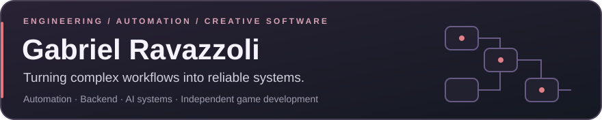
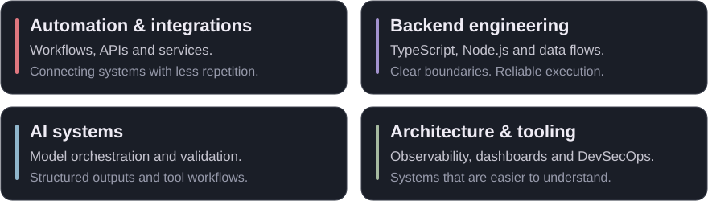
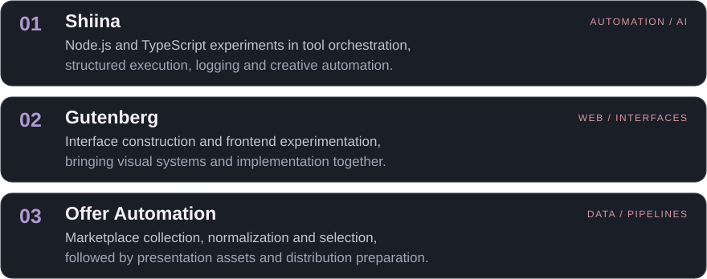
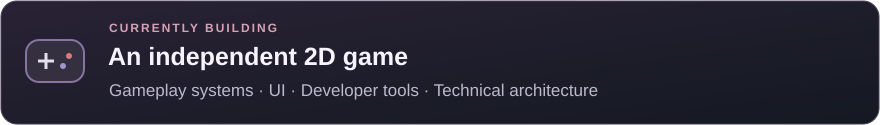

**Gabriel Ravazzoli** · DevSecOps intern · automation, infrastructure & backend
 Below is a real Pokémon FireRed game anyone can play from this page. [About me ↓](#gabriel-ravazzoli)

<!-- COMMUNITY-GBA:START -->

## POKÉMON FIRERED

Latest game snapshot · updates ~20 seconds after each command

**YOUR TURN — choose a button**

<a href="https://github.com/ravazzoligabriel-commits/ravazzoligabriel-commits/issues/new?title=%5Bgba%5D+L+12&amp;body=%23%23+Send+a+FireRed+command%0A%0A%2A%2AButton%3A+L+%C2%B7+Hold%3A+12+frames%2A%2A%0A%0A%23%23%23+1.+Send+the+command%0AClick+the+green+%2A%2ACreate+%2F+Submit+new+issue%2A%2A+button+below.+Opening+this+form+alone+does+not+send+a+command.%0A%0A%23%23%23+2.+Return+to+the+game%0A%5BBack+to+the+profile+%E2%80%94+see+the+updated+game%5D%28https%3A%2F%2Fgithub.com%2Fravazzoligabriel-commits%23pok%25C3%25A9mon-firered%29%0A%0A%2A%2AAllow+about+20+seconds%2C+then+refresh+the+profile.%2A%2A+No+need+to+close+this+Issue+%E2%80%94+the+game+closes+it+after+processing.%0A%0A%5BCheck+processing+status%5D%28https%3A%2F%2Fgithub.com%2Fravazzoligabriel-commits%2Fravazzoligabriel-commits%2Factions%2Fworkflows%2Fcommunity-gba.yml%29+if+the+screen+has+not+updated.+If+the+game+ignores+a+button%2C+the+picture+may+stay+the+same+even+after+processing.%0A%0A%2A%2ANo+pull+request%2C+code+changes+or+approval+from+the+owner+are+needed.%2A%2A+Just+submit+this+Issue.%0A%0AWait+at+least+30+seconds+between+commands+from+the+same+account.+The+command+is+read+from+the+title%3B+you+can+change+its+duration+to+1%E2%80%93120+frames.+Rejected+commands+may+also+be+closed+without+changing+the+game.%0A" title="Send L"></a><a href="https://github.com/ravazzoligabriel-commits/ravazzoligabriel-commits/issues/new?title=%5Bgba%5D+R+12&amp;body=%23%23+Send+a+FireRed+command%0A%0A%2A%2AButton%3A+R+%C2%B7+Hold%3A+12+frames%2A%2A%0A%0A%23%23%23+1.+Send+the+command%0AClick+the+green+%2A%2ACreate+%2F+Submit+new+issue%2A%2A+button+below.+Opening+this+form+alone+does+not+send+a+command.%0A%0A%23%23%23+2.+Return+to+the+game%0A%5BBack+to+the+profile+%E2%80%94+see+the+updated+game%5D%28https%3A%2F%2Fgithub.com%2Fravazzoligabriel-commits%23pok%25C3%25A9mon-firered%29%0A%0A%2A%2AAllow+about+20+seconds%2C+then+refresh+the+profile.%2A%2A+No+need+to+close+this+Issue+%E2%80%94+the+game+closes+it+after+processing.%0A%0A%5BCheck+processing+status%5D%28https%3A%2F%2Fgithub.com%2Fravazzoligabriel-commits%2Fravazzoligabriel-commits%2Factions%2Fworkflows%2Fcommunity-gba.yml%29+if+the+screen+has+not+updated.+If+the+game+ignores+a+button%2C+the+picture+may+stay+the+same+even+after+processing.%0A%0A%2A%2ANo+pull+request%2C+code+changes+or+approval+from+the+owner+are+needed.%2A%2A+Just+submit+this+Issue.%0A%0AWait+at+least+30+seconds+between+commands+from+the+same+account.+The+command+is+read+from+the+title%3B+you+can+change+its+duration+to+1%E2%80%93120+frames.+Rejected+commands+may+also+be+closed+without+changing+the+game.%0A" title="Send R"></a>

<a href="https://github.com/ravazzoligabriel-commits/ravazzoligabriel-commits/issues/new?title=%5Bgba%5D+UP+12&amp;body=%23%23+Send+a+FireRed+command%0A%0A%2A%2AButton%3A+UP+%C2%B7+Hold%3A+12+frames%2A%2A%0A%0A%23%23%23+1.+Send+the+command%0AClick+the+green+%2A%2ACreate+%2F+Submit+new+issue%2A%2A+button+below.+Opening+this+form+alone+does+not+send+a+command.%0A%0A%23%23%23+2.+Return+to+the+game%0A%5BBack+to+the+profile+%E2%80%94+see+the+updated+game%5D%28https%3A%2F%2Fgithub.com%2Fravazzoligabriel-commits%23pok%25C3%25A9mon-firered%29%0A%0A%2A%2AAllow+about+20+seconds%2C+then+refresh+the+profile.%2A%2A+No+need+to+close+this+Issue+%E2%80%94+the+game+closes+it+after+processing.%0A%0A%5BCheck+processing+status%5D%28https%3A%2F%2Fgithub.com%2Fravazzoligabriel-commits%2Fravazzoligabriel-commits%2Factions%2Fworkflows%2Fcommunity-gba.yml%29+if+the+screen+has+not+updated.+If+the+game+ignores+a+button%2C+the+picture+may+stay+the+same+even+after+processing.%0A%0A%2A%2ANo+pull+request%2C+code+changes+or+approval+from+the+owner+are+needed.%2A%2A+Just+submit+this+Issue.%0A%0AWait+at+least+30+seconds+between+commands+from+the+same+account.+The+command+is+read+from+the+title%3B+you+can+change+its+duration+to+1%E2%80%93120+frames.+Rejected+commands+may+also+be+closed+without+changing+the+game.%0A" title="Send UP"></a><a href="https://github.com/ravazzoligabriel-commits/ravazzoligabriel-commits/issues/new?title=%5Bgba%5D+A+12&amp;body=%23%23+Send+a+FireRed+command%0A%0A%2A%2AButton%3A+A+%C2%B7+Hold%3A+12+frames%2A%2A%0A%0A%23%23%23+1.+Send+the+command%0AClick+the+green+%2A%2ACreate+%2F+Submit+new+issue%2A%2A+button+below.+Opening+this+form+alone+does+not+send+a+command.%0A%0A%23%23%23+2.+Return+to+the+game%0A%5BBack+to+the+profile+%E2%80%94+see+the+updated+game%5D%28https%3A%2F%2Fgithub.com%2Fravazzoligabriel-commits%23pok%25C3%25A9mon-firered%29%0A%0A%2A%2AAllow+about+20+seconds%2C+then+refresh+the+profile.%2A%2A+No+need+to+close+this+Issue+%E2%80%94+the+game+closes+it+after+processing.%0A%0A%5BCheck+processing+status%5D%28https%3A%2F%2Fgithub.com%2Fravazzoligabriel-commits%2Fravazzoligabriel-commits%2Factions%2Fworkflows%2Fcommunity-gba.yml%29+if+the+screen+has+not+updated.+If+the+game+ignores+a+button%2C+the+picture+may+stay+the+same+even+after+processing.%0A%0A%2A%2ANo+pull+request%2C+code+changes+or+approval+from+the+owner+are+needed.%2A%2A+Just+submit+this+Issue.%0A%0AWait+at+least+30+seconds+between+commands+from+the+same+account.+The+command+is+read+from+the+title%3B+you+can+change+its+duration+to+1%E2%80%93120+frames.+Rejected+commands+may+also+be+closed+without+changing+the+game.%0A" title="Send A"></a> 
<a href="https://github.com/ravazzoligabriel-commits/ravazzoligabriel-commits/issues/new?title=%5Bgba%5D+LEFT+12&amp;body=%23%23+Send+a+FireRed+command%0A%0A%2A%2AButton%3A+LEFT+%C2%B7+Hold%3A+12+frames%2A%2A%0A%0A%23%23%23+1.+Send+the+command%0AClick+the+green+%2A%2ACreate+%2F+Submit+new+issue%2A%2A+button+below.+Opening+this+form+alone+does+not+send+a+command.%0A%0A%23%23%23+2.+Return+to+the+game%0A%5BBack+to+the+profile+%E2%80%94+see+the+updated+game%5D%28https%3A%2F%2Fgithub.com%2Fravazzoligabriel-commits%23pok%25C3%25A9mon-firered%29%0A%0A%2A%2AAllow+about+20+seconds%2C+then+refresh+the+profile.%2A%2A+No+need+to+close+this+Issue+%E2%80%94+the+game+closes+it+after+processing.%0A%0A%5BCheck+processing+status%5D%28https%3A%2F%2Fgithub.com%2Fravazzoligabriel-commits%2Fravazzoligabriel-commits%2Factions%2Fworkflows%2Fcommunity-gba.yml%29+if+the+screen+has+not+updated.+If+the+game+ignores+a+button%2C+the+picture+may+stay+the+same+even+after+processing.%0A%0A%2A%2ANo+pull+request%2C+code+changes+or+approval+from+the+owner+are+needed.%2A%2A+Just+submit+this+Issue.%0A%0AWait+at+least+30+seconds+between+commands+from+the+same+account.+The+command+is+read+from+the+title%3B+you+can+change+its+duration+to+1%E2%80%93120+frames.+Rejected+commands+may+also+be+closed+without+changing+the+game.%0A" title="Send LEFT"></a><a href="https://github.com/ravazzoligabriel-commits/ravazzoligabriel-commits/issues/new?title=%5Bgba%5D+RIGHT+12&amp;body=%23%23+Send+a+FireRed+command%0A%0A%2A%2AButton%3A+RIGHT+%C2%B7+Hold%3A+12+frames%2A%2A%0A%0A%23%23%23+1.+Send+the+command%0AClick+the+green+%2A%2ACreate+%2F+Submit+new+issue%2A%2A+button+below.+Opening+this+form+alone+does+not+send+a+command.%0A%0A%23%23%23+2.+Return+to+the+game%0A%5BBack+to+the+profile+%E2%80%94+see+the+updated+game%5D%28https%3A%2F%2Fgithub.com%2Fravazzoligabriel-commits%23pok%25C3%25A9mon-firered%29%0A%0A%2A%2AAllow+about+20+seconds%2C+then+refresh+the+profile.%2A%2A+No+need+to+close+this+Issue+%E2%80%94+the+game+closes+it+after+processing.%0A%0A%5BCheck+processing+status%5D%28https%3A%2F%2Fgithub.com%2Fravazzoligabriel-commits%2Fravazzoligabriel-commits%2Factions%2Fworkflows%2Fcommunity-gba.yml%29+if+the+screen+has+not+updated.+If+the+game+ignores+a+button%2C+the+picture+may+stay+the+same+even+after+processing.%0A%0A%2A%2ANo+pull+request%2C+code+changes+or+approval+from+the+owner+are+needed.%2A%2A+Just+submit+this+Issue.%0A%0AWait+at+least+30+seconds+between+commands+from+the+same+account.+The+command+is+read+from+the+title%3B+you+can+change+its+duration+to+1%E2%80%93120+frames.+Rejected+commands+may+also+be+closed+without+changing+the+game.%0A" title="Send RIGHT"></a><a href="https://github.com/ravazzoligabriel-commits/ravazzoligabriel-commits/issues/new?title=%5Bgba%5D+B+12&amp;body=%23%23+Send+a+FireRed+command%0A%0A%2A%2AButton%3A+B+%C2%B7+Hold%3A+12+frames%2A%2A%0A%0A%23%23%23+1.+Send+the+command%0AClick+the+green+%2A%2ACreate+%2F+Submit+new+issue%2A%2A+button+below.+Opening+this+form+alone+does+not+send+a+command.%0A%0A%23%23%23+2.+Return+to+the+game%0A%5BBack+to+the+profile+%E2%80%94+see+the+updated+game%5D%28https%3A%2F%2Fgithub.com%2Fravazzoligabriel-commits%23pok%25C3%25A9mon-firered%29%0A%0A%2A%2AAllow+about+20+seconds%2C+then+refresh+the+profile.%2A%2A+No+need+to+close+this+Issue+%E2%80%94+the+game+closes+it+after+processing.%0A%0A%5BCheck+processing+status%5D%28https%3A%2F%2Fgithub.com%2Fravazzoligabriel-commits%2Fravazzoligabriel-commits%2Factions%2Fworkflows%2Fcommunity-gba.yml%29+if+the+screen+has+not+updated.+If+the+game+ignores+a+button%2C+the+picture+may+stay+the+same+even+after+processing.%0A%0A%2A%2ANo+pull+request%2C+code+changes+or+approval+from+the+owner+are+needed.%2A%2A+Just+submit+this+Issue.%0A%0AWait+at+least+30+seconds+between+commands+from+the+same+account.+The+command+is+read+from+the+title%3B+you+can+change+its+duration+to+1%E2%80%93120+frames.+Rejected+commands+may+also+be+closed+without+changing+the+game.%0A" title="Send B"></a> 
<a href="https://github.com/ravazzoligabriel-commits/ravazzoligabriel-commits/issues/new?title=%5Bgba%5D+DOWN+12&amp;body=%23%23+Send+a+FireRed+command%0A%0A%2A%2AButton%3A+DOWN+%C2%B7+Hold%3A+12+frames%2A%2A%0A%0A%23%23%23+1.+Send+the+command%0AClick+the+green+%2A%2ACreate+%2F+Submit+new+issue%2A%2A+button+below.+Opening+this+form+alone+does+not+send+a+command.%0A%0A%23%23%23+2.+Return+to+the+game%0A%5BBack+to+the+profile+%E2%80%94+see+the+updated+game%5D%28https%3A%2F%2Fgithub.com%2Fravazzoligabriel-commits%23pok%25C3%25A9mon-firered%29%0A%0A%2A%2AAllow+about+20+seconds%2C+then+refresh+the+profile.%2A%2A+No+need+to+close+this+Issue+%E2%80%94+the+game+closes+it+after+processing.%0A%0A%5BCheck+processing+status%5D%28https%3A%2F%2Fgithub.com%2Fravazzoligabriel-commits%2Fravazzoligabriel-commits%2Factions%2Fworkflows%2Fcommunity-gba.yml%29+if+the+screen+has+not+updated.+If+the+game+ignores+a+button%2C+the+picture+may+stay+the+same+even+after+processing.%0A%0A%2A%2ANo+pull+request%2C+code+changes+or+approval+from+the+owner+are+needed.%2A%2A+Just+submit+this+Issue.%0A%0AWait+at+least+30+seconds+between+commands+from+the+same+account.+The+command+is+read+from+the+title%3B+you+can+change+its+duration+to+1%E2%80%93120+frames.+Rejected+commands+may+also+be+closed+without+changing+the+game.%0A" title="Send DOWN"></a>

<a href="https://github.com/ravazzoligabriel-commits/ravazzoligabriel-commits/issues/new?title=%5Bgba%5D+SELECT+12&amp;body=%23%23+Send+a+FireRed+command%0A%0A%2A%2AButton%3A+SELECT+%C2%B7+Hold%3A+12+frames%2A%2A%0A%0A%23%23%23+1.+Send+the+command%0AClick+the+green+%2A%2ACreate+%2F+Submit+new+issue%2A%2A+button+below.+Opening+this+form+alone+does+not+send+a+command.%0A%0A%23%23%23+2.+Return+to+the+game%0A%5BBack+to+the+profile+%E2%80%94+see+the+updated+game%5D%28https%3A%2F%2Fgithub.com%2Fravazzoligabriel-commits%23pok%25C3%25A9mon-firered%29%0A%0A%2A%2AAllow+about+20+seconds%2C+then+refresh+the+profile.%2A%2A+No+need+to+close+this+Issue+%E2%80%94+the+game+closes+it+after+processing.%0A%0A%5BCheck+processing+status%5D%28https%3A%2F%2Fgithub.com%2Fravazzoligabriel-commits%2Fravazzoligabriel-commits%2Factions%2Fworkflows%2Fcommunity-gba.yml%29+if+the+screen+has+not+updated.+If+the+game+ignores+a+button%2C+the+picture+may+stay+the+same+even+after+processing.%0A%0A%2A%2ANo+pull+request%2C+code+changes+or+approval+from+the+owner+are+needed.%2A%2A+Just+submit+this+Issue.%0A%0AWait+at+least+30+seconds+between+commands+from+the+same+account.+The+command+is+read+from+the+title%3B+you+can+change+its+duration+to+1%E2%80%93120+frames.+Rejected+commands+may+also+be+closed+without+changing+the+game.%0A" title="Send SELECT"></a><a href="https://github.com/ravazzoligabriel-commits/ravazzoligabriel-commits/issues/new?title=%5Bgba%5D+START+12&amp;body=%23%23+Send+a+FireRed+command%0A%0A%2A%2AButton%3A+START+%C2%B7+Hold%3A+12+frames%2A%2A%0A%0A%23%23%23+1.+Send+the+command%0AClick+the+green+%2A%2ACreate+%2F+Submit+new+issue%2A%2A+button+below.+Opening+this+form+alone+does+not+send+a+command.%0A%0A%23%23%23+2.+Return+to+the+game%0A%5BBack+to+the+profile+%E2%80%94+see+the+updated+game%5D%28https%3A%2F%2Fgithub.com%2Fravazzoligabriel-commits%23pok%25C3%25A9mon-firered%29%0A%0A%2A%2AAllow+about+20+seconds%2C+then+refresh+the+profile.%2A%2A+No+need+to+close+this+Issue+%E2%80%94+the+game+closes+it+after+processing.%0A%0A%5BCheck+processing+status%5D%28https%3A%2F%2Fgithub.com%2Fravazzoligabriel-commits%2Fravazzoligabriel-commits%2Factions%2Fworkflows%2Fcommunity-gba.yml%29+if+the+screen+has+not+updated.+If+the+game+ignores+a+button%2C+the+picture+may+stay+the+same+even+after+processing.%0A%0A%2A%2ANo+pull+request%2C+code+changes+or+approval+from+the+owner+are+needed.%2A%2A+Just+submit+this+Issue.%0A%0AWait+at+least+30+seconds+between+commands+from+the+same+account.+The+command+is+read+from+the+title%3B+you+can+change+its+duration+to+1%E2%80%93120+frames.+Rejected+commands+may+also+be+closed+without+changing+the+game.%0A" title="Send START"></a>

| LAST ACTION | LAST PLAYER | COMMUNITY COMMANDS |
| :---: | :---: | :---: |
| B · 12 frames | ravazzoligabriel-commits | 12 |

[How to play](#how-to-play) · [Leaderboard](#global-leaderboard--top-10) · [About me](#gabriel-ravazzoli)

---

### Global leaderboard · Top 10

**Every turn counts.** The most active players in this shared adventure.

| Rank | Player | Accepted commands |
| :---: | :--- | ---: |
| 🥇 | [@ravazzoligabriel-commits](https://github.com/ravazzoligabriel-commits) | **10** |
| 🥈 | [@joao-bortoluz](https://github.com/joao-bortoluz) | **2** |
| 3 | **Your name here** — [take a turn ↑](#pokémon-firered) | 0 |

All-time accepted commands · Updates automatically · Alphabetical tie-break · Up to 10 players

### How to play

A real game of **Pokémon FireRed**, played together through GitHub. Everyone controls the **same character and the same save**: each command continues the adventure where the last visitor left off.

> **Click a button → Create → refresh here in ~20 seconds.**
> No PR, no emulator, no ROM. One command per player every 30 seconds.

[Timing details](docs/latency.md) · [Processing status](https://github.com/ravazzoligabriel-commits/ravazzoligabriel-commits/actions/workflows/community-gba.yml)

<strong>First time here? Open the step-by-step guide</strong>

1. **Choose a button above.** It opens an Issue with the command already filled in.
2. Sign in to GitHub and click **Create / Submit new issue** to send it. Opening the Issue form alone does not send a command.
3. **[Return to the profile](https://github.com/ravazzoligabriel-commits#pok%C3%A9mon-firered) and refresh after about 20 seconds.** Queues or image caching can add time. Check the new screen before sending your next command.

You do not need to install an emulator or download the ROM. The game runs in the automation, and the README displays its output.
**Wait at least 30 seconds between commands from the same account.** Other visitors can also play and change the screen.

<strong>Button guide &amp; command duration</strong>

### What each button does in FireRed

| Button | Function |
| :--- | :--- |
| **↑ UP · ↓ DOWN · ← LEFT · → RIGHT** | Move the character and navigate menu options. |
| **A** | Confirm, talk, examine objects and advance dialogue. |
| **B** | Cancel, go back or close menus; also lets you run after obtaining the Running Shoes. |
| **START** | Open the main menu when available: Pokémon, Bag, Save and options. |
| **SELECT** | Use a registered item; on some screens, switch options, such as the name-entry keyboard. |
| **L / R** | Open FireRed's help with the default configuration; their behavior can change with the game's button settings. |

Each click holds the button for **12 frames** (about 0.2 seconds). For a longer movement,
edit the number in the Issue title: for example, `[gba] RIGHT 60`. Commands accept **1 to 120 frames**.
Some dialogues need more than one **A** command. Progress is saved automatically between commands.

[Command queue](https://github.com/ravazzoligabriel-commits/ravazzoligabriel-commits/issues?q=is%3Aissue+is%3Aopen+%5Bgba%5D) · [Raw game screen](assets/community/screen.png) · [How the project works](docs/community-gba.md)

<!-- COMMUNITY-GBA:END -->

---

# Gabriel Ravazzoli

[Focus](#what-i-work-with) · [Projects](#selected-projects) · [Building](#currently-building) · [Toolbox](#toolbox) · [Play FireRed](#pokémon-firered)

DevSecOps intern. Day to day I automate infrastructure, wire up integrations and build backend services and dashboards.
Main stack: **TypeScript / Node.js, GitHub Actions, Docker, AWS and Azure**.
On the side I build AI-assisted pipelines and an indie 2D game in Godot.

The FireRed game above is a good sample of how I work: a Python + mGBA emulator running inside GitHub Actions, driven by Issues, with a persistent save, cooldowns and a leaderboard. [See how it works →](docs/community-gba.md)

## What I work with

## Selected projects

These repositories are private for now — happy to walk through them on request.

<strong>Project details</strong>

**Shiina** — An automation and AI experimentation project built around Node.js and TypeScript. It explores tool orchestration, structured execution, logging and small creative automation experiments.

**Gutenberg** — A web project focused on interface construction, product structure and frontend experimentation. A space to refine visual systems and implementation together.

**Offer Automation** — An end-to-end pipeline for product offers: collecting marketplace data, normalizing it, applying selection logic, generating presentation assets and preparing content for distribution.

**Featured experiment:** [Community FireRed](https://github.com/ravazzoligabriel-commits/ravazzoligabriel-commits) — a real GBA game controlled through GitHub Issues, with one shared save and a global leaderboard. [Take a turn ↑](#pokémon-firered)

## Currently building

Game development is where I explore state, interaction and visual feedback beyond traditional web and backend work.

## Toolbox

**Languages & applications**

**Infrastructure & engineering**

<strong>Professional experience</strong>

In a professional engineering environment, I work with internal automation, backend services, dashboards, integrations, architecture and engineering tooling. Company-specific systems and internal implementation details stay private.

---

**Build with intention. Make it observable. Keep it simple.**

Automation, engineering and a little creative experimentation.

[Back to the adventure ↑](#pokémon-firered)

