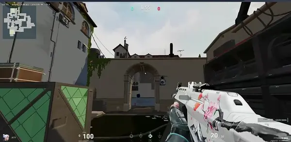
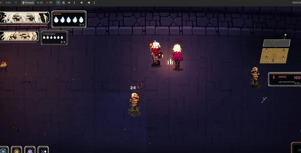

<!-- COMMUNITY-GBA:START -->

## ACTUAL GAME RUNNING IN GITHUB

**Yes, this is a real game, not a GIF.** A GBA emulator runs through GitHub Actions; this profile shows the actual latest frame.

**How to play:** Click a button below, submit the prefilled **GitHub Issue**, then refresh this page after about 20 seconds. One shared save. Everyone takes a turn.

**Practical? Absolutely not. Impressive? You tell me.**

[How to play](#how-to-play) · [How it works](docs/community-gba.md)

Latest game snapshot · updates ~20 seconds after each command

**YOUR TURN · CLICK A BUTTON TO PLAY**

<table align="center">
<tr>
<td align="center" colspan="2"><a href="https://github.com/ravazzoligabriel-commits/ravazzoligabriel-commits/issues/new?title=%5Bgba%5D+L+12&amp;body=%23%23+Send+a+FireRed+command%0A%0A%2A%2AButton%3A+L+%C2%B7+Hold%3A+12+frames%2A%2A%0A%0A%23%23%23+1.+Send+the+command%0AClick+the+green+%2A%2ACreate+%2F+Submit+new+issue%2A%2A+button+below.+Opening+this+form+alone+does+not+send+a+command.%0A%0A%23%23%23+2.+Return+to+the+game%0A%5BBack+to+the+profile+%E2%80%94+see+the+updated+game%5D%28https%3A%2F%2Fgithub.com%2Fravazzoligabriel-commits%23actual-game-running-in-github%29%0A%0A%2A%2AAllow+about+20+seconds%2C+then+refresh+the+profile.%2A%2A+No+need+to+close+this+Issue+%E2%80%94+the+game+closes+it+after+processing.%0A%0A%5BCheck+processing+status%5D%28https%3A%2F%2Fgithub.com%2Fravazzoligabriel-commits%2Fravazzoligabriel-commits%2Factions%2Fworkflows%2Fcommunity-gba.yml%29+if+the+screen+has+not+updated.+If+the+game+ignores+a+button%2C+the+picture+may+stay+the+same+even+after+processing.%0A%0A%2A%2ANo+pull+request%2C+code+changes+or+approval+from+the+owner+are+needed.%2A%2A+Just+submit+this+Issue.%0A%0AWait+at+least+30+seconds+between+commands+from+the+same+account.+The+command+is+read+from+the+title%3B+you+can+change+its+duration+to+1%E2%80%93120+frames.+Rejected+commands+may+also+be+closed+without+changing+the+game.%0A" title="Send L"></a></td>
<td></td>
<td align="center" colspan="2"><a href="https://github.com/ravazzoligabriel-commits/ravazzoligabriel-commits/issues/new?title=%5Bgba%5D+R+12&amp;body=%23%23+Send+a+FireRed+command%0A%0A%2A%2AButton%3A+R+%C2%B7+Hold%3A+12+frames%2A%2A%0A%0A%23%23%23+1.+Send+the+command%0AClick+the+green+%2A%2ACreate+%2F+Submit+new+issue%2A%2A+button+below.+Opening+this+form+alone+does+not+send+a+command.%0A%0A%23%23%23+2.+Return+to+the+game%0A%5BBack+to+the+profile+%E2%80%94+see+the+updated+game%5D%28https%3A%2F%2Fgithub.com%2Fravazzoligabriel-commits%23actual-game-running-in-github%29%0A%0A%2A%2AAllow+about+20+seconds%2C+then+refresh+the+profile.%2A%2A+No+need+to+close+this+Issue+%E2%80%94+the+game+closes+it+after+processing.%0A%0A%5BCheck+processing+status%5D%28https%3A%2F%2Fgithub.com%2Fravazzoligabriel-commits%2Fravazzoligabriel-commits%2Factions%2Fworkflows%2Fcommunity-gba.yml%29+if+the+screen+has+not+updated.+If+the+game+ignores+a+button%2C+the+picture+may+stay+the+same+even+after+processing.%0A%0A%2A%2ANo+pull+request%2C+code+changes+or+approval+from+the+owner+are+needed.%2A%2A+Just+submit+this+Issue.%0A%0AWait+at+least+30+seconds+between+commands+from+the+same+account.+The+command+is+read+from+the+title%3B+you+can+change+its+duration+to+1%E2%80%93120+frames.+Rejected+commands+may+also+be+closed+without+changing+the+game.%0A" title="Send R"></a></td>
</tr>
<tr>
<td></td>
<td align="center"><a href="https://github.com/ravazzoligabriel-commits/ravazzoligabriel-commits/issues/new?title=%5Bgba%5D+UP+12&amp;body=%23%23+Send+a+FireRed+command%0A%0A%2A%2AButton%3A+UP+%C2%B7+Hold%3A+12+frames%2A%2A%0A%0A%23%23%23+1.+Send+the+command%0AClick+the+green+%2A%2ACreate+%2F+Submit+new+issue%2A%2A+button+below.+Opening+this+form+alone+does+not+send+a+command.%0A%0A%23%23%23+2.+Return+to+the+game%0A%5BBack+to+the+profile+%E2%80%94+see+the+updated+game%5D%28https%3A%2F%2Fgithub.com%2Fravazzoligabriel-commits%23actual-game-running-in-github%29%0A%0A%2A%2AAllow+about+20+seconds%2C+then+refresh+the+profile.%2A%2A+No+need+to+close+this+Issue+%E2%80%94+the+game+closes+it+after+processing.%0A%0A%5BCheck+processing+status%5D%28https%3A%2F%2Fgithub.com%2Fravazzoligabriel-commits%2Fravazzoligabriel-commits%2Factions%2Fworkflows%2Fcommunity-gba.yml%29+if+the+screen+has+not+updated.+If+the+game+ignores+a+button%2C+the+picture+may+stay+the+same+even+after+processing.%0A%0A%2A%2ANo+pull+request%2C+code+changes+or+approval+from+the+owner+are+needed.%2A%2A+Just+submit+this+Issue.%0A%0AWait+at+least+30+seconds+between+commands+from+the+same+account.+The+command+is+read+from+the+title%3B+you+can+change+its+duration+to+1%E2%80%93120+frames.+Rejected+commands+may+also+be+closed+without+changing+the+game.%0A" title="Send UP"></a></td>
<td></td>
<td></td>
<td align="center"><a href="https://github.com/ravazzoligabriel-commits/ravazzoligabriel-commits/issues/new?title=%5Bgba%5D+A+12&amp;body=%23%23+Send+a+FireRed+command%0A%0A%2A%2AButton%3A+A+%C2%B7+Hold%3A+12+frames%2A%2A%0A%0A%23%23%23+1.+Send+the+command%0AClick+the+green+%2A%2ACreate+%2F+Submit+new+issue%2A%2A+button+below.+Opening+this+form+alone+does+not+send+a+command.%0A%0A%23%23%23+2.+Return+to+the+game%0A%5BBack+to+the+profile+%E2%80%94+see+the+updated+game%5D%28https%3A%2F%2Fgithub.com%2Fravazzoligabriel-commits%23actual-game-running-in-github%29%0A%0A%2A%2AAllow+about+20+seconds%2C+then+refresh+the+profile.%2A%2A+No+need+to+close+this+Issue+%E2%80%94+the+game+closes+it+after+processing.%0A%0A%5BCheck+processing+status%5D%28https%3A%2F%2Fgithub.com%2Fravazzoligabriel-commits%2Fravazzoligabriel-commits%2Factions%2Fworkflows%2Fcommunity-gba.yml%29+if+the+screen+has+not+updated.+If+the+game+ignores+a+button%2C+the+picture+may+stay+the+same+even+after+processing.%0A%0A%2A%2ANo+pull+request%2C+code+changes+or+approval+from+the+owner+are+needed.%2A%2A+Just+submit+this+Issue.%0A%0AWait+at+least+30+seconds+between+commands+from+the+same+account.+The+command+is+read+from+the+title%3B+you+can+change+its+duration+to+1%E2%80%93120+frames.+Rejected+commands+may+also+be+closed+without+changing+the+game.%0A" title="Send A"></a></td>
</tr>
<tr>
<td align="center"><a href="https://github.com/ravazzoligabriel-commits/ravazzoligabriel-commits/issues/new?title=%5Bgba%5D+LEFT+12&amp;body=%23%23+Send+a+FireRed+command%0A%0A%2A%2AButton%3A+LEFT+%C2%B7+Hold%3A+12+frames%2A%2A%0A%0A%23%23%23+1.+Send+the+command%0AClick+the+green+%2A%2ACreate+%2F+Submit+new+issue%2A%2A+button+below.+Opening+this+form+alone+does+not+send+a+command.%0A%0A%23%23%23+2.+Return+to+the+game%0A%5BBack+to+the+profile+%E2%80%94+see+the+updated+game%5D%28https%3A%2F%2Fgithub.com%2Fravazzoligabriel-commits%23actual-game-running-in-github%29%0A%0A%2A%2AAllow+about+20+seconds%2C+then+refresh+the+profile.%2A%2A+No+need+to+close+this+Issue+%E2%80%94+the+game+closes+it+after+processing.%0A%0A%5BCheck+processing+status%5D%28https%3A%2F%2Fgithub.com%2Fravazzoligabriel-commits%2Fravazzoligabriel-commits%2Factions%2Fworkflows%2Fcommunity-gba.yml%29+if+the+screen+has+not+updated.+If+the+game+ignores+a+button%2C+the+picture+may+stay+the+same+even+after+processing.%0A%0A%2A%2ANo+pull+request%2C+code+changes+or+approval+from+the+owner+are+needed.%2A%2A+Just+submit+this+Issue.%0A%0AWait+at+least+30+seconds+between+commands+from+the+same+account.+The+command+is+read+from+the+title%3B+you+can+change+its+duration+to+1%E2%80%93120+frames.+Rejected+commands+may+also+be+closed+without+changing+the+game.%0A" title="Send LEFT"></a></td>
<td align="center"></td>
<td align="center"><a href="https://github.com/ravazzoligabriel-commits/ravazzoligabriel-commits/issues/new?title=%5Bgba%5D+RIGHT+12&amp;body=%23%23+Send+a+FireRed+command%0A%0A%2A%2AButton%3A+RIGHT+%C2%B7+Hold%3A+12+frames%2A%2A%0A%0A%23%23%23+1.+Send+the+command%0AClick+the+green+%2A%2ACreate+%2F+Submit+new+issue%2A%2A+button+below.+Opening+this+form+alone+does+not+send+a+command.%0A%0A%23%23%23+2.+Return+to+the+game%0A%5BBack+to+the+profile+%E2%80%94+see+the+updated+game%5D%28https%3A%2F%2Fgithub.com%2Fravazzoligabriel-commits%23actual-game-running-in-github%29%0A%0A%2A%2AAllow+about+20+seconds%2C+then+refresh+the+profile.%2A%2A+No+need+to+close+this+Issue+%E2%80%94+the+game+closes+it+after+processing.%0A%0A%5BCheck+processing+status%5D%28https%3A%2F%2Fgithub.com%2Fravazzoligabriel-commits%2Fravazzoligabriel-commits%2Factions%2Fworkflows%2Fcommunity-gba.yml%29+if+the+screen+has+not+updated.+If+the+game+ignores+a+button%2C+the+picture+may+stay+the+same+even+after+processing.%0A%0A%2A%2ANo+pull+request%2C+code+changes+or+approval+from+the+owner+are+needed.%2A%2A+Just+submit+this+Issue.%0A%0AWait+at+least+30+seconds+between+commands+from+the+same+account.+The+command+is+read+from+the+title%3B+you+can+change+its+duration+to+1%E2%80%93120+frames.+Rejected+commands+may+also+be+closed+without+changing+the+game.%0A" title="Send RIGHT"></a></td>
<td align="center"><a href="https://github.com/ravazzoligabriel-commits/ravazzoligabriel-commits/issues/new?title=%5Bgba%5D+B+12&amp;body=%23%23+Send+a+FireRed+command%0A%0A%2A%2AButton%3A+B+%C2%B7+Hold%3A+12+frames%2A%2A%0A%0A%23%23%23+1.+Send+the+command%0AClick+the+green+%2A%2ACreate+%2F+Submit+new+issue%2A%2A+button+below.+Opening+this+form+alone+does+not+send+a+command.%0A%0A%23%23%23+2.+Return+to+the+game%0A%5BBack+to+the+profile+%E2%80%94+see+the+updated+game%5D%28https%3A%2F%2Fgithub.com%2Fravazzoligabriel-commits%23actual-game-running-in-github%29%0A%0A%2A%2AAllow+about+20+seconds%2C+then+refresh+the+profile.%2A%2A+No+need+to+close+this+Issue+%E2%80%94+the+game+closes+it+after+processing.%0A%0A%5BCheck+processing+status%5D%28https%3A%2F%2Fgithub.com%2Fravazzoligabriel-commits%2Fravazzoligabriel-commits%2Factions%2Fworkflows%2Fcommunity-gba.yml%29+if+the+screen+has+not+updated.+If+the+game+ignores+a+button%2C+the+picture+may+stay+the+same+even+after+processing.%0A%0A%2A%2ANo+pull+request%2C+code+changes+or+approval+from+the+owner+are+needed.%2A%2A+Just+submit+this+Issue.%0A%0AWait+at+least+30+seconds+between+commands+from+the+same+account.+The+command+is+read+from+the+title%3B+you+can+change+its+duration+to+1%E2%80%93120+frames.+Rejected+commands+may+also+be+closed+without+changing+the+game.%0A" title="Send B"></a></td>
<td></td>
</tr>
<tr>
<td></td>
<td align="center"><a href="https://github.com/ravazzoligabriel-commits/ravazzoligabriel-commits/issues/new?title=%5Bgba%5D+DOWN+12&amp;body=%23%23+Send+a+FireRed+command%0A%0A%2A%2AButton%3A+DOWN+%C2%B7+Hold%3A+12+frames%2A%2A%0A%0A%23%23%23+1.+Send+the+command%0AClick+the+green+%2A%2ACreate+%2F+Submit+new+issue%2A%2A+button+below.+Opening+this+form+alone+does+not+send+a+command.%0A%0A%23%23%23+2.+Return+to+the+game%0A%5BBack+to+the+profile+%E2%80%94+see+the+updated+game%5D%28https%3A%2F%2Fgithub.com%2Fravazzoligabriel-commits%23actual-game-running-in-github%29%0A%0A%2A%2AAllow+about+20+seconds%2C+then+refresh+the+profile.%2A%2A+No+need+to+close+this+Issue+%E2%80%94+the+game+closes+it+after+processing.%0A%0A%5BCheck+processing+status%5D%28https%3A%2F%2Fgithub.com%2Fravazzoligabriel-commits%2Fravazzoligabriel-commits%2Factions%2Fworkflows%2Fcommunity-gba.yml%29+if+the+screen+has+not+updated.+If+the+game+ignores+a+button%2C+the+picture+may+stay+the+same+even+after+processing.%0A%0A%2A%2ANo+pull+request%2C+code+changes+or+approval+from+the+owner+are+needed.%2A%2A+Just+submit+this+Issue.%0A%0AWait+at+least+30+seconds+between+commands+from+the+same+account.+The+command+is+read+from+the+title%3B+you+can+change+its+duration+to+1%E2%80%93120+frames.+Rejected+commands+may+also+be+closed+without+changing+the+game.%0A" title="Send DOWN"></a></td>
<td></td>
<td></td>
<td></td>
</tr>
<tr>
<td align="center" colspan="2"><a href="https://github.com/ravazzoligabriel-commits/ravazzoligabriel-commits/issues/new?title=%5Bgba%5D+SELECT+12&amp;body=%23%23+Send+a+FireRed+command%0A%0A%2A%2AButton%3A+SELECT+%C2%B7+Hold%3A+12+frames%2A%2A%0A%0A%23%23%23+1.+Send+the+command%0AClick+the+green+%2A%2ACreate+%2F+Submit+new+issue%2A%2A+button+below.+Opening+this+form+alone+does+not+send+a+command.%0A%0A%23%23%23+2.+Return+to+the+game%0A%5BBack+to+the+profile+%E2%80%94+see+the+updated+game%5D%28https%3A%2F%2Fgithub.com%2Fravazzoligabriel-commits%23actual-game-running-in-github%29%0A%0A%2A%2AAllow+about+20+seconds%2C+then+refresh+the+profile.%2A%2A+No+need+to+close+this+Issue+%E2%80%94+the+game+closes+it+after+processing.%0A%0A%5BCheck+processing+status%5D%28https%3A%2F%2Fgithub.com%2Fravazzoligabriel-commits%2Fravazzoligabriel-commits%2Factions%2Fworkflows%2Fcommunity-gba.yml%29+if+the+screen+has+not+updated.+If+the+game+ignores+a+button%2C+the+picture+may+stay+the+same+even+after+processing.%0A%0A%2A%2ANo+pull+request%2C+code+changes+or+approval+from+the+owner+are+needed.%2A%2A+Just+submit+this+Issue.%0A%0AWait+at+least+30+seconds+between+commands+from+the+same+account.+The+command+is+read+from+the+title%3B+you+can+change+its+duration+to+1%E2%80%93120+frames.+Rejected+commands+may+also+be+closed+without+changing+the+game.%0A" title="Send SELECT"></a></td>
<td></td>
<td align="center" colspan="2"><a href="https://github.com/ravazzoligabriel-commits/ravazzoligabriel-commits/issues/new?title=%5Bgba%5D+START+12&amp;body=%23%23+Send+a+FireRed+command%0A%0A%2A%2AButton%3A+START+%C2%B7+Hold%3A+12+frames%2A%2A%0A%0A%23%23%23+1.+Send+the+command%0AClick+the+green+%2A%2ACreate+%2F+Submit+new+issue%2A%2A+button+below.+Opening+this+form+alone+does+not+send+a+command.%0A%0A%23%23%23+2.+Return+to+the+game%0A%5BBack+to+the+profile+%E2%80%94+see+the+updated+game%5D%28https%3A%2F%2Fgithub.com%2Fravazzoligabriel-commits%23actual-game-running-in-github%29%0A%0A%2A%2AAllow+about+20+seconds%2C+then+refresh+the+profile.%2A%2A+No+need+to+close+this+Issue+%E2%80%94+the+game+closes+it+after+processing.%0A%0A%5BCheck+processing+status%5D%28https%3A%2F%2Fgithub.com%2Fravazzoligabriel-commits%2Fravazzoligabriel-commits%2Factions%2Fworkflows%2Fcommunity-gba.yml%29+if+the+screen+has+not+updated.+If+the+game+ignores+a+button%2C+the+picture+may+stay+the+same+even+after+processing.%0A%0A%2A%2ANo+pull+request%2C+code+changes+or+approval+from+the+owner+are+needed.%2A%2A+Just+submit+this+Issue.%0A%0AWait+at+least+30+seconds+between+commands+from+the+same+account.+The+command+is+read+from+the+title%3B+you+can+change+its+duration+to+1%E2%80%93120+frames.+Rejected+commands+may+also+be+closed+without+changing+the+game.%0A" title="Send START"></a></td>
</tr>
</table>

| LAST ACTION | LAST PLAYER | COMMUNITY COMMANDS |
| :---: | :---: | :---: |
| DOWN · 12 frames | ravazzoligabriel-commits | 14 |

[How to play](#how-to-play) · [Leaderboard](#global-leaderboard--top-10) · [How it works](docs/community-gba.md)

---

### Global leaderboard · Top 10

**Every turn counts.** The most active players in this shared adventure.

| Rank | Player | Accepted commands |
| :---: | :--- | ---: |
| 🥇 | [@ravazzoligabriel-commits](https://github.com/ravazzoligabriel-commits) | **12** |
| 🥈 | [@joao-bortoluz](https://github.com/joao-bortoluz) | **2** |
| 3 | **Your name here** — [take a turn ↑](#actual-game-running-in-github) | 0 |

All-time accepted commands · Updates automatically · Alphabetical tie-break · Up to 10 players

### How to play

A real game of **Pokémon FireRed**, played together through GitHub. Everyone controls the **same character and the same save**: each command continues the adventure where the last visitor left off.

> **Click a button → Create → refresh here in ~20 seconds.**
> No PR, no emulator, no ROM. One command per player every 30 seconds.

[Timing details](docs/latency.md) · [Processing status](https://github.com/ravazzoligabriel-commits/ravazzoligabriel-commits/actions/workflows/community-gba.yml)

<strong>First time here? Open the step-by-step guide</strong>

1. **Choose a button above.** It opens an Issue with the command already filled in.
2. Sign in to GitHub and click **Create / Submit new issue** to send it. Opening the Issue form alone does not send a command.
3. **[Return to the profile](https://github.com/ravazzoligabriel-commits#actual-game-running-in-github) and refresh after about 20 seconds.** Queues or image caching can add time. Check the new screen before sending your next command.

You do not need to install an emulator or download the ROM. The game runs in the automation, and the README displays its output.
**Wait at least 30 seconds between commands from the same account.** Other visitors can also play and change the screen.

<strong>Button guide &amp; command duration</strong>

### What each button does in FireRed

| Button | Function |
| :--- | :--- |
| **↑ UP · ↓ DOWN · ← LEFT · → RIGHT** | Move the character and navigate menu options. |
| **A** | Confirm, talk, examine objects and advance dialogue. |
| **B** | Cancel, go back or close menus; also lets you run after obtaining the Running Shoes. |
| **START** | Open the main menu when available: Pokémon, Bag, Save and options. |
| **SELECT** | Use a registered item; on some screens, switch options, such as the name-entry keyboard. |
| **L / R** | Open FireRed's help with the default configuration; their behavior can change with the game's button settings. |

Each click holds the button for **12 frames** (about 0.2 seconds). For a longer movement,
edit the number in the Issue title: for example, `[gba] RIGHT 60`. Commands accept **1 to 120 frames**.
Some dialogues need more than one **A** command. Progress is saved automatically between commands.

[Command queue](https://github.com/ravazzoligabriel-commits/ravazzoligabriel-commits/issues?q=is%3Aissue+is%3Aopen+%5Bgba%5D) · [Raw game screen](assets/community/screen.png) · [How the project works](docs/community-gba.md)

<!-- COMMUNITY-GBA:END -->

---

<!-- CURRENTLY-BUILDING:START -->

## WHAT I'M BUILDING RIGHT NOW

<table>
<tr>
<td width="50%" valign="top" align="center">
<h3>VALORANT, BUT IN MY BROWSER</h3>

 
Real FPS gameplay, rendered in the browser.
  
Unofficial fan experiment · Work in progress
</td>
<td width="50%" valign="top" align="center">
<h3>SIGILO · OCCULT ROGUELITE</h3>

 
Pixel-art combat, rituals and cosmic horror.
  
Indie game prototype · Work in progress
</td>
</tr>
</table>

<!-- CURRENTLY-BUILDING:END -->
