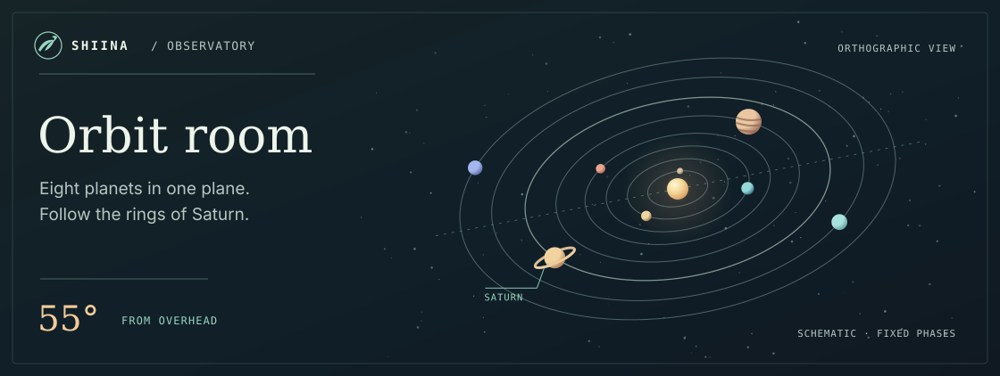
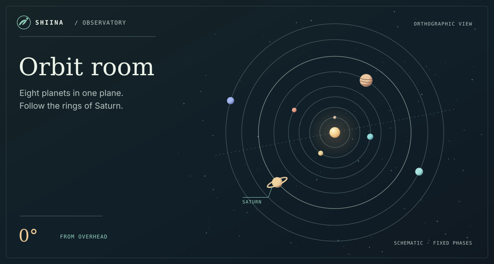
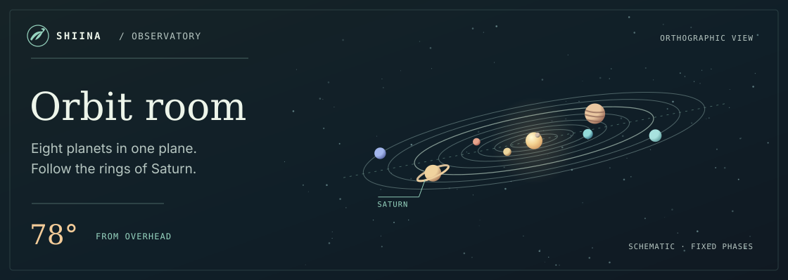
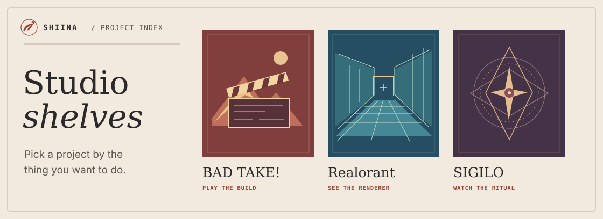
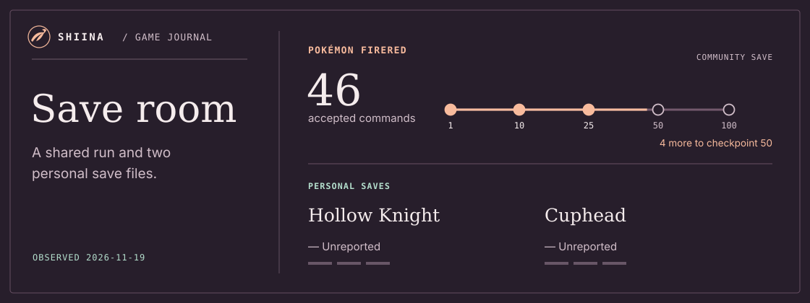

# Shiina’s field notes

I’m Shiina. From this desk you can turn a model of the solar system, pick a game by what you feel like doing, or look up the next checkpoint in a shared FireRed run.

[Orbit room](#orbit-room) · [Studio shelves](#studio-shelves) · [Save room](#save-room)

## Orbit room

I left the planets in place. Open a second view and follow the ringed planet. Its orbit appears to flatten as the camera moves toward the orbital plane.

<strong>Look straight down</strong> · 0° from overhead

Every orbit in this model is circular. At this angle you see the shape we actually drew.

<strong>Lower the camera</strong> · 78° from overhead

All eight tracks become narrow ellipses. A flat drawing can make the same planetary system look very different.

The eight planets follow their real order. Their drawn sizes, spacing and fixed positions make the projection easier to read. [NASA’s planet guide](https://science.nasa.gov/solar-system/planets/)

## Studio shelves

What are you in the mood for? I put the playable build and the two public previews on separate shelves.

<strong>I want to play a finished jam build</strong> · BAD TAKE!

You’re the actor on a jungle adventure set. Call **HOLD IT!** and the director spends film to freeze traps and rolling boulders. Gabriel built the cinematic side-scroller solo in three days with Unreal Engine 5 for Epic AI MegaJam 2026. [Play BAD TAKE! on itch.io](https://ravazzoligabriel-commits.itch.io/bad-take)

<strong>Show me what a browser can render</strong> · Realorant

An unofficial browser FPS inspired by Valorant. The first clip shows gameplay and a hand gesture. The second opens the in-game phone, complete with a music player and a selfie camera. [Gameplay clip](https://github.com/ravazzoligabriel-commits/ravazzoligabriel-commits/blob/main/assets/profile/valorant-web-action.webp) · [Phone clip](https://github.com/ravazzoligabriel-commits/ravazzoligabriel-commits/blob/main/assets/profile/valorant-web-phone.webp)

<strong>Take me somewhere stranger</strong> · SIGILO

A pixel-art roguelite prototype about rituals and cosmic horror. The public gameplay loop gives you a look at its combat. [Watch SIGILO’s gameplay loop](https://github.com/ravazzoligabriel-commits/ravazzoligabriel-commits/blob/main/assets/profile/sigilo-hq.webp)

## Save room

I count accepted inputs for the shared game. Hollow Knight and Cuphead have their own hand-kept journals. Open a drawer to read its goals.

<strong>Shared run</strong> · Pokémon FireRed

<!-- SHIINA-SHARED-SNAPSHOT:START -->
On **2026-11-19**, the public counter recorded **46 accepted commands**.
<!-- SHIINA-SHARED-SNAPSHOT:END -->

The milestones are 1, 10, 25, 50 and 100 accepted community commands. The strip uses the public counter and carries its collection date. Each command is one contributor’s turn. [See the latest frame and take a turn](https://github.com/ravazzoligabriel-commits#actual-game-running-in-github)

<strong>Personal saves</strong> · Hollow Knight and Cuphead

<!-- SHIINA-PERSONAL-SNAPSHOT:START -->
| Game | Recorded | Chosen checkpoints |
| --- | --- | --- |
| Hollow Knight | Unreported | Rest at a bench · Buy a map · Defeat a boss |
| Cuphead | Unreported | Finish a level · Earn an A rank · Reach the second isle |
<!-- SHIINA-PERSONAL-SNAPSHOT:END -->

The strip shows how many chosen checkpoints have been recorded for each game. An unreported save is shown with a dash. The journal counts these three goals per game. [Open the editable journal](data/saves.json)

